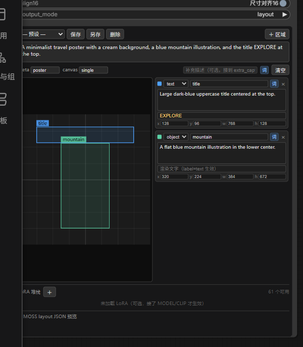

# PromptForge · 提示词工坊

[English](#english) | 中文

一个 ComfyUI 节点装下：整图画布、逐区域 bbox 提示词、词库选词、预设保存/加载、多 LoRA 加载，
直接输出 **MOSS-Image 官方 layout JSON**。



## 安装

```bash
cd ComfyUI/custom_nodes
git clone https://github.com/wwapw29/ComfyUI-PromptForge.git
```

重启 ComfyUI，在 `PromptForge` 分类下找到「PromptForge 提示词工坊」。无第三方依赖，不需要 pip install。

## 为什么是 MOSS 的格式

MOSS 的 layout 不是「自然语言里塞坐标」，它有两条硬性约定，写错一位整张图就散：

| 字段 | 值 | 含义 |
|---|---|---|
| `bbox_format` | `yxyx` | `[y_min, x_min, y_max, x_max]`，**不是** `xyxy` |
| `bbox_coord_space` | `abs_centralized` | 绝对像素，**以画布中心为原点**，y 轴向下 |

1024×1024 的画布，取值范围是 -512 ~ +512。换算公式：
`中心坐标 = 左上坐标 - (W/2 或 H/2)`。

UI 里你按左上原点画，节点内部自动换算，不用心算。

## 节点输出

| 端口 | 类型 | 说明 |
|---|---|---|
| `layout_json` | STRING | 直接喂给 CLIPTextEncode / MOSS 的 positive prompt |
| `caption` | STRING | 纯文本版（summary + 各区域描述，无坐标），给不认 layout 的模型用 |
| `width` / `height` | INT | 对齐后的尺寸，接 EmptyLatentImage |
| `lora_stack` | STRING | 已应用列表，`name:model:clip` 每行一条 |
| `model` / `clip` | MODEL/CLIP | 应用 LoRA 后的模型 |

`output_mode` 三档：`layout`（紧凑 JSON，省 token）、`layout_pretty`（缩进，肉眼检查）、`caption_only`（纯文本）。

## 界面怎么用

- **画布**：空白处按住拖 → 新建区域；拖区域内部 → 移动；选中后拖八个白点 → 缩放
- **拉高节点**：面板跟着变高，多出来的空间自动分给画布/列表，或 JSON 预览（看它是不是展开的）
- **区域列表**：每行 `object` / `text`（text 才吃「渲染文字」那一栏）、区域名、caption
- **词库**：区域行那个 `词` 按钮，从 Danbooru-Gallery 的 PromptSelector 词库里挑词条直接插进这一格的 caption；
  整图描述右侧也有一个 `词` 按钮。支持搜索（别名 + 内容）、按分类筛、示意图缩略图
- **按份插入 / 再点撤掉**：同一个词点一次算一份，再点一次撤掉一份。已插入的行会变绿并打勾，
  插了多份会显示 `✓2`。记录存在每个区域的 `chips` 里，跟着工作流走
- **悬停预览**：鼠标停在词条上约 0.26 秒，旁边弹出预览卡 —— 大图 + 别名 + 分类 + **完整提示词全文**
- **弹层可拖可缩**：拖标题栏移动，拖右下角缩放。位置、尺寸、上次选的分类都会记住
- **新增 / 编辑词条**：弹层右上 `＋` 新增，条目 hover 出现 `✎` 编辑。改分类会把词条搬过去，不会重复
- **补充描述**：工具条右侧那一栏，内容追加到 `summary.caption` 末尾；等价于连 `extra_caption` 输入
- **预设**：`保存` 覆盖当前 / `另存` 新建 / `删除`。文件落在本目录 `presets/*.json`，自带一个示例
- **LoRA**：`＋` 加一行，左侧选文件，两个数字分别是 model / clip 强度。没接 MODEL/CLIP 时不要留 LoRA 行，会直接报错

## 词库怎么接的

不复制、不另存一份词库 —— 直接读写 `ComfyUI-Danbooru-Gallery` 的接口：

| 用途 | 接口 |
|---|---|
| 读整包 | `GET /prompt_selector/data` |
| 写整包（新增/编辑词条） | `POST /prompt_selector/data` |
| 上传示意图 | `POST /prompt_selector/upload_image` |
| 取图 | `GET /prompt_selector/preview/{filename}` |

- 词库在那边改，这边点 `↻` 刷新就同步（不点就用打开时的缓存）
- 没装 Danbooru-Gallery 或它的接口没注册，`词` 按钮点开会在列表区显示原因，不会静默失败
- 插入时按光标位置拼，前面已有内容会自动补 `, `
- 新增/编辑走「读最新 → 改 → 整包写回」，写前重新 GET 一次，不会拿旧缓存覆盖别处刚做的改动。
  服务端是原子保存，每次写都自动生成 `data.json.backup_时间戳`
- 但如果你**正开着 Danbooru-Gallery 的编辑界面且没保存**，它那边的旧内存数据仍可能把你的改动盖掉

## 尺寸对齐

`align16` 默认开。MOSS 只吃 16 的倍数，其它值会报错或出图糊。关了就别怪它。

## 已知限制

- 面板高度跟着节点走：**JSON 预览收起时**，多出来的高度给画布和区域列表；**展开时**，画布/列表最高 380px，
  剩下的全给 JSON（两者都有保底高度）。面板最小 340px，再小就挤了
- 可选输入 `model` / `clip` 的圆点在节点左上角，标签会被面板压掉一半，但点得到
- 区域坐标是绝对像素。改 `width`/`height` 后已有框不会按比例缩放，超出部分会被裁到边界
- MOSS 的 layout 是 experimental 功能，效果取决于底模；坐标对了不代表构图一定听话
- 词库功能依赖 `ComfyUI-Danbooru-Gallery`，没装则只保留手写提示词和预设

## 注意事项

- LoRA 只在实际有 MODEL 或 CLIP 输入时才加载；两者都没接会抛错，这是故意的，避免误以为加载了
- `preset` 名字只能有中英文、数字、空格、`_` `-` `.`
- 工作流里所有区域数据存在隐藏 widget `forge_data` 里，复制节点即复制全部内容

## 结构

```
ComfyUI-PromptForge/
├── __init__.py       注册节点 + 挂载 js
├── nodes.py          layout 组装、坐标换算、LoRA 加载
├── server.py         /prompt_forge/* 预设接口
├── js/prompt_forge.js 画布、面板、词库弹层
├── presets/          预设文件（example-* 会进仓库，其余被 .gitignore 忽略）
└── assets/           README 用图
```

---

## English

A single ComfyUI node that does the whole prompt-assembly job for **MOSS-Image layout prompts**:

- **Draw bounding boxes** on a canvas (drag to create, drag to move, 8 handles to resize), each with its own prompt
- **Region list** on the right: `object` / `text` label, name, caption, and optional text-to-render
- **Tag library** panel wired to [ComfyUI-Danbooru-Gallery](https://github.com/...) `PromptSelector`
  (optional dependency). Click a tag to insert, click again to remove. Search, filter by category,
  thumbnails, hover preview, and add/edit entries with images.
- **Presets** save the whole layout; popup remembers its position, size and last category
- **LoRA stack** built in — feed MODEL/CLIP in and pick LoRAs with model/clip strengths

Outputs `layout_json` in MOSS's official format (`bbox_format: yxyx`, `bbox_coord_space: abs_centralized`,
i.e. **pixel coordinates with the canvas center as origin**), plus a plain `caption`, the aligned
`width`/`height`, and the post-LoRA `MODEL`/`CLIP`.

### Install

```bash
cd ComfyUI/custom_nodes
git clone https://github.com/wwapw29/ComfyUI-PromptForge.git
```

Restart ComfyUI and find **PromptForge** under the `PromptForge` category. No pip dependencies.

### Notes

- The tag-library panel requires `ComfyUI-Danbooru-Gallery`; without it the node still works with
  hand-written prompts and presets.
- Coordinates are stored as absolute pixels (top-left origin) and converted to MOSS's centered
  coordinate space on output. Changing canvas size does not rescale existing boxes.
- MOSS layout prompts are an experimental model feature; correct coordinates do not guarantee the
  composition you expect.

## License

MIT
